# Veridash

**Drop your data. Trust every number.**

Veridash turns a clean CSV or Excel file into a health check, a column profile, recommended charts and KPIs,
written insights and ready-to-use exports in seconds, and shows exactly what changed between two versions of a
file. Every number is computed by code and shown next to the
exact query that produced it, and any AI-written sentence is fact-checked against those results. A public
trust benchmark measures how well those checks work: the fact-check catches 96.0% of
1,004 planted wrong numbers with 0 false alarms.

**Live demo:** [veridash.streamlit.app](https://veridash.streamlit.app)

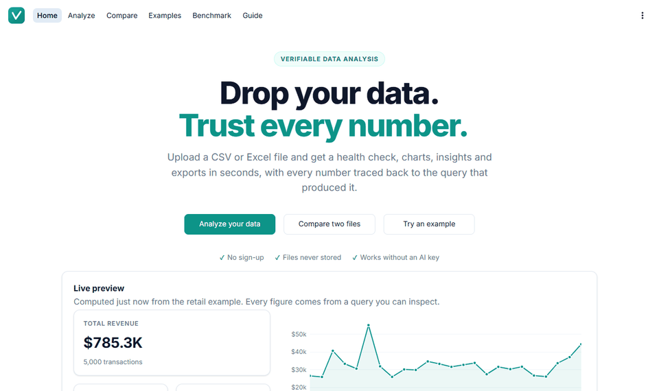

---

## Why I built this

Most of the time in a first analysis goes to work that comes before any insight: checking whether the file is
clean, working out which columns matter, building the first charts and writing up what they show. AI assistants
promise to speed this up, but they often produce numbers that cannot be traced to anything, and a number you
cannot defend is worse than no number at all.

I am working toward data analyst, BI and data engineering roles, and the habit I value most in those roles is
being able to show where every figure came from. I built Veridash to prove that AI can make analysis faster
without giving up that standard: the code does the math, the AI only explains it, and the app checks its work.

## About the project

Veridash is a web app for analysts, students and business users who need a fast, trustworthy first read of a
tabular dataset. A user uploads a file or picks an example, and the app returns a scored health check, KPIs,
four to eight charts chosen from the shape of the data, insights in plain English, answers to questions, and
exports for Excel, PDF and Power BI. A second file can be compared with the first to see what changed. It is built on three pillars:

- **Verified numbers:** every chart and KPI comes from a real SQL query that is shown on screen, and AI text is
  fact-checked number by number.
- **Private by design:** files are processed in memory and never stored, and the AI sees only the schema and
  aggregated statistics, never raw rows.
- **Export to your tools:** results leave the app as a shareable web report, an Excel report with native
  charts, a PDF summary or a Power BI Starter Kit.

## Goals

- **Make the first hour of analysis take a minute** without cutting corners on data quality.
- **Keep every number traceable** to the query that produced it.
- **Use AI only where it adds value,** for selecting and explaining facts, never for calculating them.
- **Respect privacy by default** by keeping files in memory and sending only summaries to the AI.
- **Hand off cleanly** to the tools analysts already use: Excel, PDF and Power BI.
- **Measure the safeguards** instead of just describing them, and publish the results.

---

## Features

### Data health check
- **Score and grade:** a 0 to 100 health score with an A to F grade, built from a published formula.
- **Weighted checks:** penalties for missing cells, duplicate rows, mixed-type columns, constant columns and a
  high share of outliers, each capped so no single problem dominates.
- **Plain-English issues:** every issue has a severity, a "why it matters" line and a practical "how to fix"
  step with Excel and Power Query pointers, also included in the Excel and PDF reports.
- **Smart parsing:** currency, percentages and accounting negatives such as (123) are read as numbers.
- **Take the clean data with you:** the Data tab downloads the cleaned data (or just the rows matching a
  search) and a data dictionary describing every column.

### Smart charts and KPIs
- **Chosen by data shape:** trends over time, what drove the latest change, top-N rankings, share of total, rates by group, distributions,
  spread by group, a correlation heatmap and a scatter of the strongest pair.
- **One-sentence insights:** each chart states what it shows, using numbers from its own query.
- **"How this was calculated":** every chart and KPI shows the exact SQL that ran and the table it returned.
- **Adjustable:** the primary metric, date column and date grain can be changed at any time.
- **Light and dark mode:** the app follows the visitor's system setting, with color-blind-safe chart palettes validated for both.

### AI insights with fact-checking
- **Structured output:** an executive summary, key findings, recommendations framed as hypotheses with evidence
  and a way to validate them, and data caveats.
- **Citations:** each statement cites the computed facts it relies on.
- **Fact-check badge:** every number in the AI's text is matched to a computed fact, allowing for rounding, and
  the badge reports the result, for example "Verified numbers: 12/12". Unverified numbers are highlighted, not hidden.
- **Direction and group checks:** a stated direction must be right ("rose 1.1%" fails for a fall), and a group's
  number must belong to the group named next to it ("Electronics comes to $209.1K" fails when that is Apparel's).
- **Eight languages:** AI insights can be written in English, Spanish, French, German, Portuguese, Italian, Dutch
  or Vietnamese. Numbers keep one format in every language, so the fact-check works the same way.
- **Works without a key:** rule-based insights with the same structure are always available.
- **Check anyone's numbers:** paste a paragraph from a colleague's report or an AI chat, and every number in it
  is checked against the file, with the reason for any that fail.

### Compare two files
- **What changed, at a glance:** rows, the main metric, data health and columns side by side for a before and
  an after file, such as last month's export and this month's.
- **Where the change came from:** a diverging chart and a table of the groups that moved the metric most.
- **Column and record changes:** columns added, removed or retyped, and, with a shared ID column, the records
  that are new, gone or changed.
- **Fact-checked and traceable:** a plain-English summary whose numbers all pass the fact-check, the SQL behind
  every figure, and the whole comparison as a downloadable CSV. Two one-click examples are included.

### Ask your data
- **Quick questions:** up to five one-click questions built from the columns, such as totals by group, the trend
  as a table, the largest records and missing values per column. They run plain SQL and need no key.
- **Plain-English questions:** Gemini writes a single SQL query, which Veridash validates before running.
- **Strict safety rules:** read-only queries only, no file access, a row limit and a timeout.
- **Transparent results:** the SQL, the result table and an automatic chart are shown together.
- **SQL mode:** without a key, users can write their own queries under the same safety rules.

### Exports: a web report, Excel, PDF, the Power BI Starter Kit and an audit trail
- **Shareable web report:** one HTML file that opens in any browser with no app, account or internet. It has
  the KPIs, health check, charts and insights, and every verified number links to the fact and SQL behind it.
- **Excel report:** a summary sheet, the column profile, one sheet per chart with a native Excel chart and its
  query, and the full dataset as a filterable table.
- **PDF summary:** a two to four page report with the health score, KPIs, top charts, insights and methodology.
- **Power BI Starter Kit:** the cleaned data, a Power Query script with correct column types, DAX measures
  (totals, averages, share of total, year-over-year, month-over-month and running totals), a date table and a
  five-step quickstart.
- **Audit trail:** a CSV of every number Veridash computed, with its fact ID, whether the insights cite it,
  and the exact SQL behind it, so anyone can re-check the work outside the app.

### Example datasets
- **Retail sales:** two years of store transactions across regions, categories and products.
- **HR workforce:** departments, roles, tenure, performance, satisfaction, overtime and attrition.
- **Investment portfolio:** holdings across fictional tickers and sectors with market value and gain or loss.
- **Built to be checked:** each dataset is synthetic, reproducible and seeded with realistic data issues.

---

## Screenshots

| Home | Analyze overview |
|---|---|
| 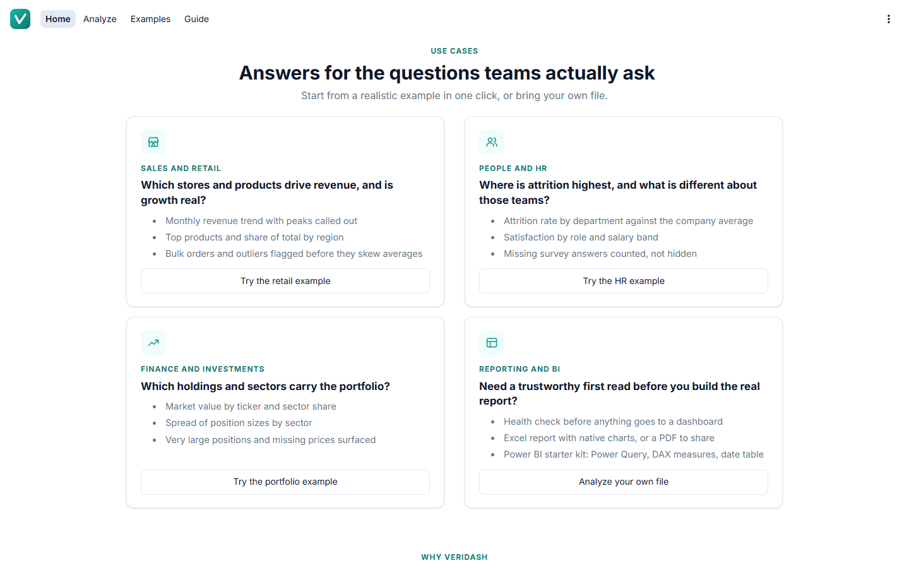 | 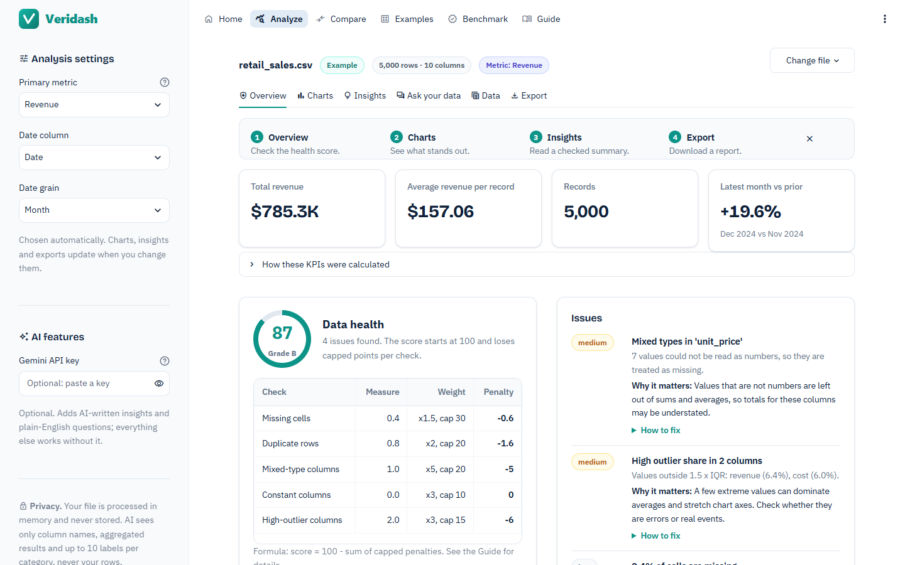 |
| **Charts** | **Insights with fact-check badge** |
| 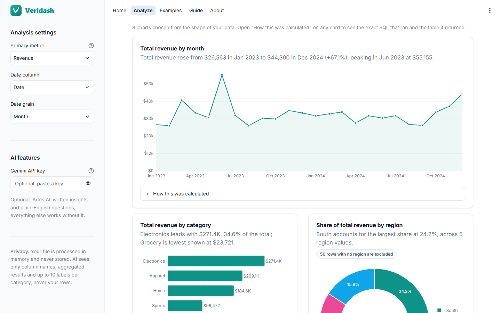 | 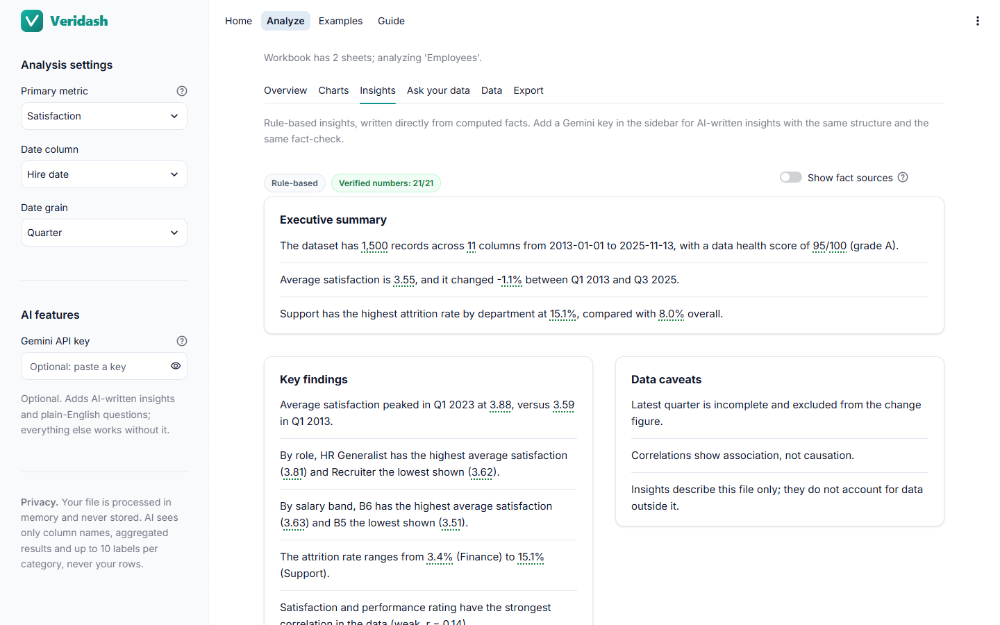 |
| **Ask your data** | **Exports** |
| 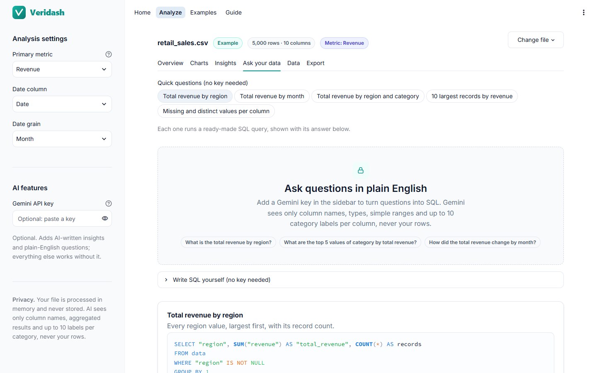 | 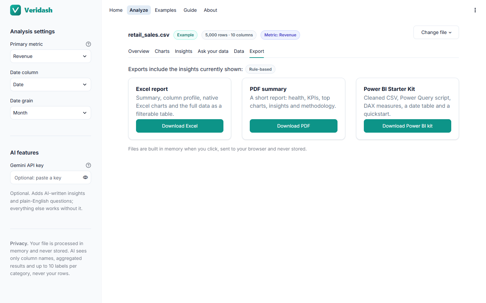 |
| **Trust benchmark** | **Shareable web report** |
| 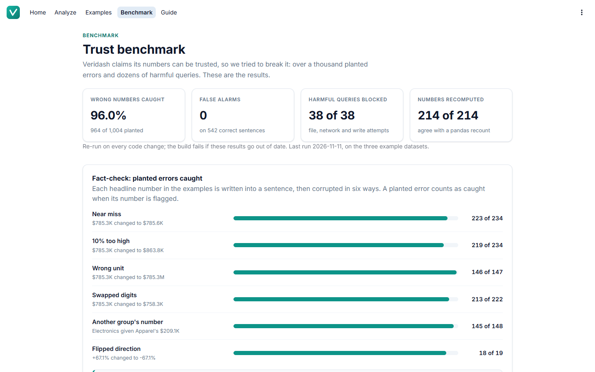 | 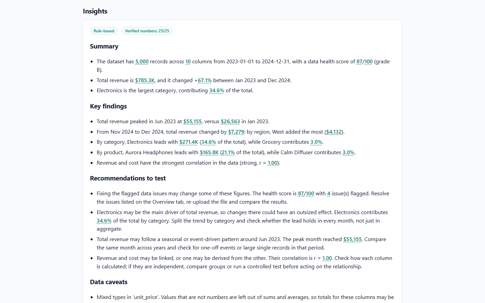 |
| **Compare two files** | **Check someone else's numbers** |
| 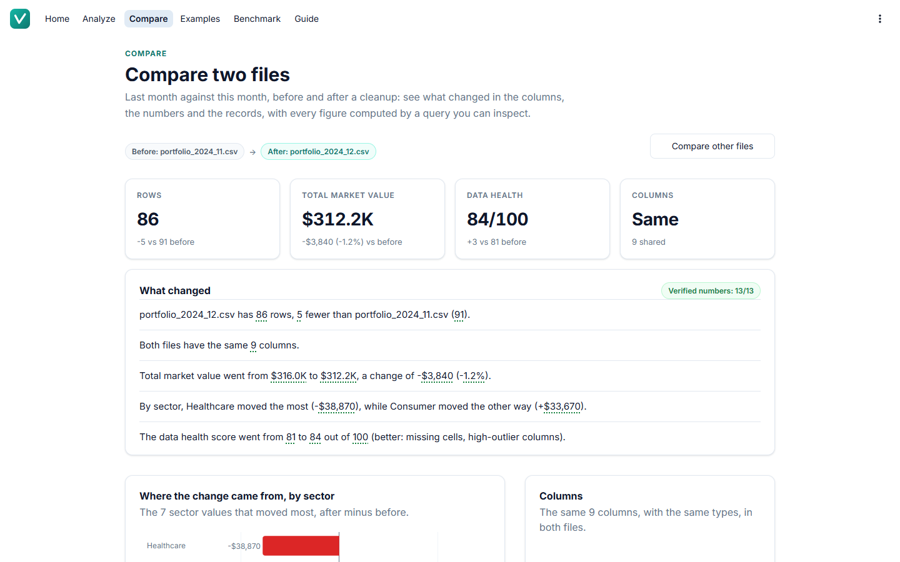 | 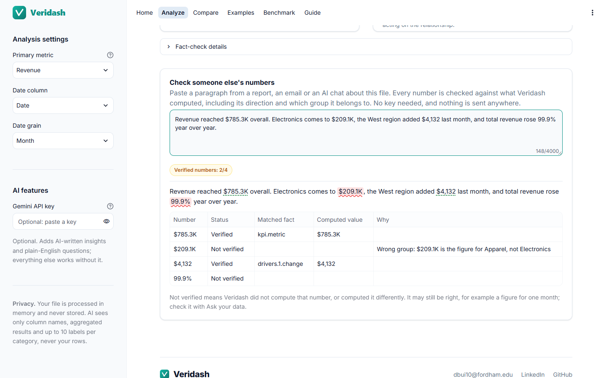 |

## How it works

1. **Upload a file** or choose one of the three example datasets.
2. **Review the health check** to see how clean the data is and what to watch out for.
3. **Explore the recommended charts and KPIs,** and open any of them to see how it was calculated.
4. **Read the insights,** written by AI when a key is available or by rules otherwise, with every number checked.
5. **Ask follow-up questions** in plain English or write your own query.
6. **Export the results** as a web report, or to Excel, PDF or Power BI, and continue in your usual tools.
7. **Next month, compare** the new file with the old one to see what changed and where.

## Architecture

Veridash is organised in four layers. The **interface** handles pages, navigation and the design system. The
**analysis engine** loads the file, detects column types, scores data health, and runs every calculation as
SQL in an in-memory database that cannot read or write files. The **AI layer** receives only a "fact pack" of
results the engine has already computed, writes insights or a query, and has every number in its output
checked. The **comparison** stacks two files into one table so that every difference is also a single
query. The **exports** layer turns the same results into a web report and Excel, PDF and Power BI files
without writing anything to disk. Alongside the app, a **trust benchmark** attacks the fact-check and the
query guard and recomputes every headline number without SQL; it runs on every push.

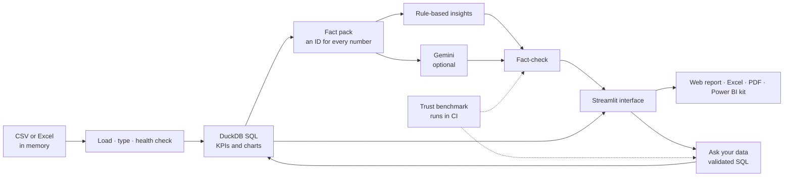

## Key design decisions

- **The AI never does math.** Language models are good at explaining and poor at arithmetic, so every number is
  computed by code and the AI only selects and explains from that list. This removes a whole class of errors
  instead of trying to catch them afterwards.
- **Every chart shows its real query.** The SQL on screen is the exact string that ran, alongside the table it
  returned. Anyone can audit a figure without trusting the app.
- **AI output is fact-checked.** Every number in AI text is matched to a computed fact at the precision it was
  written. Anything that does not match is flagged in red, so problems stay visible instead of hidden.
- **Only summaries reach the AI.** The AI sees the schema and aggregated results, never raw rows. This keeps
  personal and sensitive records private and keeps prompts small and fast.
- **A Power BI kit instead of a .pbix.** The .pbix format cannot be generated reliably outside Power BI Desktop,
  so Veridash produces plain Power Query and DAX that any analyst can read, review and paste in minutes.
- **Safeguards are measured, not just claimed.** The benchmark plants wrong numbers and harmful queries and
  publishes how many are caught. Its first run caught 77.9% and exposed two blind spots, numbers given to the
  wrong group and flipped signs, which led to the checks that now catch them.
- **A transparent health score.** The score uses one published formula and one set of weights, shown in full in
  the Guide, so a grade can always be explained and challenged.

## Tech stack

| Layer | Tools |
|---|---|
| Interface | Streamlit, custom design system, Plotly |
| Analysis engine | pandas, NumPy, DuckDB |
| AI | Google Gen AI SDK with Gemini, structured JSON output |
| Exports | xlsxwriter for Excel, fpdf2 and matplotlib for PDF, Power Query and DAX for Power BI |
| Quality | pytest with Streamlit AppTest, Ruff, GitHub Actions, a deterministic trust benchmark |

## Project structure

| Part | What it does |
|---|---|
| App entry point | Sets up the page, theme, navigation between the six pages and the site footer. |
| Pages | Home (use cases and how Veridash differs), Analyze, Compare, Examples, Benchmark and Guide. |
| Analysis engine | Loads files, detects types, scores health, runs sandboxed SQL, picks charts and KPIs, builds the fact pack, writes rule-based insights and compares two files. |
| AI layer | Connects to Gemini, writes AI insights, fact-checks numbers and turns questions into validated SQL. |
| Exports | Builds the web report, the Excel report, the PDF summary, the Power BI Starter Kit, the audit trail and the comparison CSV. |
| Interface kit | The theme, chart styling and reusable components such as cards, badges and callouts. |
| Sample data | Three synthetic datasets and the seeded script that generates them. |
| Trust benchmark | Plants errors and harmful queries, recomputes numbers with pandas and publishes the scores. |
| Tests | Automated checks for every module, every page and all three examples end to end. |
| Documentation | Setup and deployment guide, architecture notes and design decisions. |

## Testing and quality

| Area | What is checked |
|---|---|
| File loading | CSV and Excel, encodings, delimiters, empty, headerless and oversized files |
| Type detection and health | Every column type, currency and percent parsing, scoring formula, caps and grades |
| Charts and KPIs | Every recommended query runs, returns data and matches an independent calculation |
| Fact-checking | Verified, unverified and rounding cases, signs and directions, group labels, years and dates |
| Query safety | Writes, multiple statements, file access and blocked functions are all rejected |
| Exports | The Excel file opens with all sheets, the PDF has two to four pages, the Power BI kit has every file, the web report is self-contained and escaped |
| Comparison | Column, health, metric and record changes, groups missing from one file, rounding, and a fully verified summary |
| App | Every page renders, all three examples run end to end without a key, and edge-case files do not break |

All 276 automated tests pass on every push (GitHub Actions), and the codebase is lint-clean under Ruff.

### Trust benchmark

The benchmark runs on the three example datasets with no randomness and no AI calls, and the build fails if
its published results go out of date. The same scores are shown on the app's Benchmark page.

| Check | Result |
|---|---|
| Planted wrong numbers caught by the fact-check | 964 of 1,004 (96.0%) |
| Correct sentences wrongly flagged | 0 of 542 |
| Near misses, such as $785.3K written as $785.6K | 223 of 234 caught |
| Another group's number | 145 of 148 caught |
| Flipped direction | 18 of 19 caught |
| Harmful queries blocked by the query guard | 38 of 38 |
| File, network and setting attacks blocked by the sandbox alone | 17 of 17 |
| Harmless queries that still run | 25 of 25 |
| Numbers matching an independent pandas recomputation, including both comparisons | 258 of 258 |

Every remaining miss is a wrong number that happens to equal another real figure in the same file, which no
number check can tell apart.

## Roadmap

- **PBIP project with a semantic model,** once it can be validated against Power BI Desktop.
- **Joining related files,** such as orders and customers, with a guided key picker.
- **Significance tests** for group differences, reported alongside the existing hypotheses.
- **Compare a series of files,** such as twelve monthly exports, as a trend of what changed.
- **Benchmark the AI itself:** measure how often Gemini's insights pass the fact-check across many files.

## Conclusion

Veridash brings together the parts of data work I enjoy most: cleaning and profiling data, writing SQL,
designing clear charts and KPIs, and handing results off to BI tools. It also reflects how I think AI should
be used in analytics, as a fast and helpful explainer that works inside guardrails rather than as a source of
numbers.

Building it taught me how much of a tool's credibility comes from transparency. Showing the query behind each
chart, publishing the health formula and flagging unverified numbers took more work than hiding them, but those
choices are what make the results something I would be comfortable presenting to a manager or a client.
Measuring my own fact-checker was the most humbling step: it missed whole kinds of errors I had assumed it
caught, and fixing them made the tool better than any amount of reasoning about it would have.

For setup and deployment instructions, see the [Setup Guide](docs/SETUP.md). For what changed in each version,
see the [Changelog](CHANGELOG.md).

## Author

For any inquiries or questions regarding the project, please contact me at: [dbui10@fordham.edu](mailto:dbui10@fordham.edu) · [LinkedIn](https://www.linkedin.com/in/dangquanbui/)
