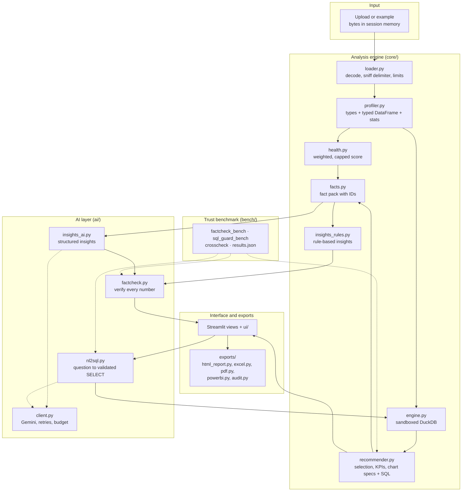
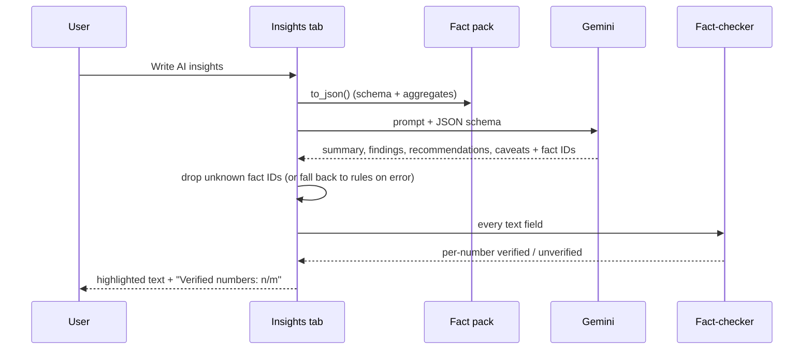

# Architecture

How data flows through Veridash, from upload to export.

## Overview

## Step by step

1. **Input.** The uploaded file (or an example) is read into `st.session_state` as bytes. Nothing is written to
   disk. A SHA-256 fingerprint of the bytes (plus the sheet name) becomes the cache key.
2. **Load** (`core/loader.py`). CSV bytes are decoded with utf-8, utf-8-sig or latin-1, the delimiter is sniffed,
   and column names are trimmed and de-duplicated. Excel files are read with openpyxl or xlrd, with a sheet
   picker for multi-sheet workbooks. Size, row and column limits produce clear `LoadError` messages.
3. **Profile** (`core/profiler.py`). Each column is classified as number, date, category, boolean, text or id.
   Currency, percent and accounting formats are parsed into numbers; date strings into datetimes; yes/no into
   booleans. The result is a *typed* DataFrame that every later step queries, plus per-column statistics.
4. **Health** (`core/health.py`). Five weighted, capped checks produce the score, grade and issues.
5. **Select** (`core/recommender.py`). The primary metric, aggregation (SUM or AVG), date column, grain and
   categories are chosen from priority lists and data shape; sidebar overrides win.
6. **Compute** (`core/engine.py`, `core/recommender.py`). The typed DataFrame is registered in an in-memory
   DuckDB connection with external access disabled and locked. Each KPI and chart runs its own SQL; the result,
   a one-sentence insight and a list of facts are stored on the spec. For totals and counts over time, one
   query also breaks the latest change down by group.
7. **Fact pack** (`core/facts.py`). Dataset, health, KPI, chart and profile facts are collected, each with a
   stable dotted ID such as `kpi.metric` or `top.1.share_pct`.
8. **Insights.** Rule-based insights are always generated from the fact pack. With a key, `ai/insights_ai.py`
   sends the fact pack (never rows) to Gemini with a JSON schema, drops citations to unknown fact IDs and falls
   back to rules on any error. `ai/factcheck.py` then checks every number in whichever text is shown.
9. **Ask your data** (`ai/nl2sql.py`). The question plus schema context goes to Gemini, which returns one query.
   `validate_sql` checks it and adds a `LIMIT`; the engine runs it with a timeout. Users can also type SQL.
10. **Exports** (`exports/`). Built lazily when a download button is clicked, fully in memory: an xlsxwriter
    workbook (`in_memory` mode) with native charts, an fpdf2 PDF with matplotlib images, a zip with CSV, M
    and DAX, an audit-trail CSV listing every fact with the SQL that produced it, and a self-contained HTML
    report (inline SVG charts, no JavaScript) whose verified numbers link to the facts they matched.
11. **Trust benchmark** (`bench/`, outside the app). `python -m bench` plants wrong numbers in sentences built
    from the examples' facts and scores the fact-checker, sends harmful and harmless SQL through the guard and
    the sandbox, and recomputes headline numbers with pandas. Results go to `bench/results.json`, which the
    Benchmark page reads; CI runs `python -m bench --check` and fails if they are out of date.

## Module map

| Package | Responsibility | Depends on |
|---|---|---|
| `core/` | Loading, typing, health, SQL engine, recommendations, facts, rule-based insights, pipeline | pandas, NumPy, DuckDB |
| `ai/` | Gemini client, AI insights, fact-checking, natural-language SQL | `core/`, google-genai |
| `exports/` | Web report, Excel, PDF, Power BI and audit-trail outputs | `core/`, `ai/factcheck`, xlsxwriter, fpdf2, matplotlib |
| `bench/` | Trust benchmark: fact-check, SQL guard and pandas cross-check suites, published results | `core/`, `ai/` |
| `ui/` | Theme, components, Plotly figures, session state and caching, tab views | `core/`, `ai/`, `exports/`, Streamlit, Plotly |
| `views/` | The five pages: Home, Analyze, Examples, Benchmark, Guide | `ui/`, `bench/` (published results only) |
| `app.py` | Page config, theme injection, navigation | `ui/`, `views/` |

`core/` never imports Streamlit, so the whole engine can be tested and reused without the UI. The one shared
entry point is `core/pipeline.py`: `prepare()` loads, profiles and health-checks a file once; `analyze()` builds
everything that depends on the user's choices.

## State and caching

| What | Where | Lifetime |
|---|---|---|
| Uploaded bytes and the active source | `st.session_state` | The browser session |
| Prepared file and analysis results | `st.cache_data`, keyed on the file fingerprint and choices | Server memory, up to 1 hour, at most 8 to 16 entries |
| AI insights and Ask history | `st.session_state`, keyed per file and choice | The browser session |
| AI call counter | `st.session_state` | The browser session (10 calls) |
| Sidebar Gemini key | `st.session_state` | The browser session; never logged |

## Security model

- **No disk writes.** Uploads, analysis and exports stay in memory (`xlsxwriter` runs in `in_memory` mode).
- **No raw rows to the AI.** Only the fact pack, or the schema with up to 10 labels per category column.
- **Sandboxed SQL.** `enable_external_access = false` plus a locked configuration, a parser-backed validator,
  a timeout and a row cap.
- **Escaped HTML.** Every user-provided string placed into HTML goes through `html.escape()`, in
  `ui/components.py` for the app and in `exports/html_report.py` for the downloadable report, which also
  contains no scripts and loads nothing from the internet.
- **Secrets.** Keys come from the sidebar, `st.secrets` or the environment; `secrets.toml` is gitignored.

## AI insights sequence

